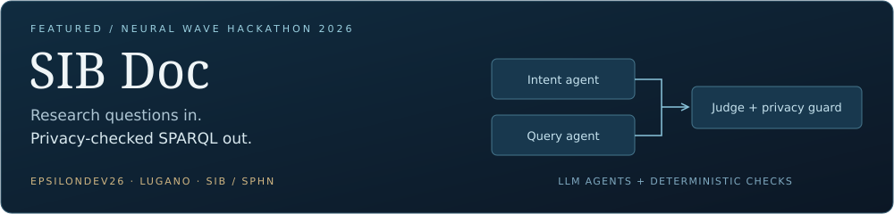
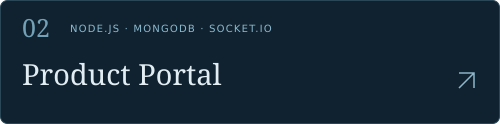
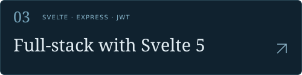
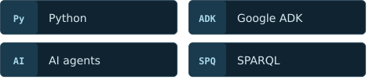
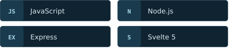
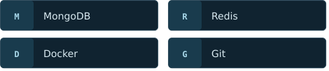
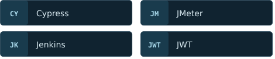

&nbsp;

&nbsp;

I'm **David García Costa**, a Computer Engineering graduate from Spain, currently pursuing a **Master's in Artificial Intelligence at USI Lugano**.

My work brings together **AI agents, software testing and backend integration**. I've developed agents with Google ADK, explored AI-assisted QA automation in my bachelor's thesis, and built full-stack applications with authentication, databases and real-time features.

<table width="100%">
<tr>
<td width="50%" valign="top">

**📍 Based in** 
Lugano, Switzerland 🇨🇭

**🎓 Studying** 
MSc Artificial Intelligence · USI

</td>
<td width="50%" valign="top">

**🧠 Focus** 
AI agents · Intelligent automation

**⚙️ Experience** 
Software QA · Backend & full-stack development

</td>
</tr>
</table>

Built with **EpsilonDev26** for the **SIB / SPHN challenge** at Neural Wave 2026 in Lugano. SIB Doc translates research questions into SPARQL queries over clinical knowledge graphs, then validates the query and checks privacy compliance.

<table width="100%">
<tr>
<td width="50%" valign="top">

**My contribution** 
Backend development, API integration, orchestration and deployment.

</td>
<td width="50%" valign="top">

**The team system** 
Intent agent + query agent, deterministic validation and a privacy compliance guard.

</td>
</tr>
</table>

[▶ Watch the project demo](https://youtu.be/6jT3EJk6Cb4) &nbsp; · &nbsp; [EpsilonDev26](https://github.com/EpsilonDev26)

 

My bachelor's thesis explored **automating software quality-assurance workflows with AI agents**, connecting test management and automated testing.

 

<table width="100%">
<tr>
<td width="50%" valign="top">

Product management with **JWT authentication**, admin/user roles and **real-time chat** with persistent message history.

**Built with** 
Node.js · Express · MongoDB · Socket.IO

[Explore repository ↗](https://github.com/DavidGarciaCosta/portal-productos)

</td>
<td width="50%" valign="top">

A protected **Svelte 5 SPA** with product CRUD, user administration, admin/user roles and session persistence.

**Built with** 
Svelte 5 · Express · MongoDB · Redis

[Explore repository ↗](https://github.com/DavidGarciaCosta/PracticaSvelte5_David)

</td>
</tr>
</table>

<table width="100%">
<tr>
<td width="50%" valign="top" align="center">

**AI & agents**

</td>
<td width="50%" valign="top" align="center">

**Web & applications**

</td>
</tr>
<tr>
<td width="50%" valign="top" align="center">

**Data & delivery**

</td>
<td width="50%" valign="top" align="center">

**Testing & authentication**

</td>
</tr>
</table>

Interested in **AI agents, QA automation or software development**? You can find me on [LinkedIn](https://www.linkedin.com/in/david-garc%C3%ADa-costa/) and explore my work here on GitHub.

 

